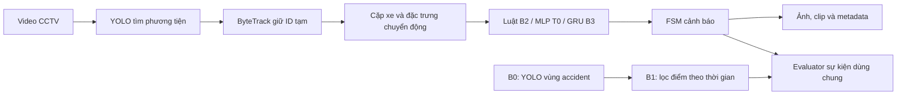

# DACN Traffic Collision

Đồ án nghiên cứu phát hiện và cảnh báo va chạm xe–xe từ video CCTV cố định. Mục tiêu là hiểu liệu quỹ đạo và diễn biến chuyển động có giúp giảm báo sai, đồng thời đo chi phí của toàn hệ thống. Các kết quả hiện nay là pilot; chưa có benchmark sự kiện độc lập để kết luận RQ1/RQ2.

## Luồng xử lý



YOLO vehicle pretrained tìm xe; B0 là detector `accident` riêng. ByteTrack gán ID tạm trong một video. Bbox chồng nhau, điểm luật hoặc cảnh báo thử nghiệm chưa tự chứng minh va chạm. Không suy FPS nguồn CADP từ FPS trình chiếu.

## Baseline và trạng thái

| Baseline | Vai trò | Trạng thái ngắn |
| --- | --- | --- |
| B0 | Detector vùng accident từng ảnh | Có nhiều run và metric validation ảnh; chưa benchmark sự kiện độc lập. |
| B1 | EMA hoặc k-of-N trên điểm B0 | Đã replay cache; chưa so recall sự kiện độc lập. |
| B2 | Vehicle YOLO + ByteTrack + luật chuyển động | Đã có pipeline offline và evidence; báo nghi vấn trên video âm còn cao. |
| T0 | MLP trên đặc trưng cặp xe hiện tại | Có code và gate; chưa train do thiếu release nhãn phù hợp. |
| B3 / T1 | GRU một chiều trên cửa sổ quá khứ | Cùng một baseline; có code/gate, chưa train. |

Trạng thái chi tiết, điều kiện hoàn thành và liên kết nhật ký nằm ở **[progress/README.md](progress/README.md)**; đây là bảng tiến độ duy nhất. Hồ sơ sự kiện, nhãn và dữ liệu phải phân biệt nguồn tác giả, dữ liệu chưa rõ nhãn, validation và test độc lập.

## Bắt đầu trên máy mới

Muốn xem cây gọn trong VS Code, mở [DACN_Explore.code-workspace](DACN_Explore.code-workspace); khi cần kiểm dataset/output lịch sử, mở [DACN_Full.code-workspace](DACN_Full.code-workspace). Output mới dùng [kiến trúc lưu artifact](docs/STORAGE_ARCHITECTURE.md) và [registry](data/registries/project_explorer.json); dashboard Explore có một tab **Tìm artifact** cho cả vị trí chuẩn và LEGACY.

1. Đọc [GETTING_STARTED](docs/GETTING_STARTED.md): môi trường, các file cần tải, nguồn và vị trí lưu.
2. Xem [catalog dữ liệu](data/download_catalog.json), rồi chạy `scripts/check_project_assets.py` theo hướng dẫn để kiểm file thật. Media, checkpoint và môi trường lớn không có sẵn sau khi clone Git.
3. Xem [scripts/README](scripts/README.md) để chọn lệnh; không cần chạy tất cả. Đọc [AGENTS.md](AGENTS.md) và [workbook định hướng](YOLO_Lo_trinh_DACN.xlsx) trước khi thay đổi hướng, dữ liệu, model hoặc đánh giá.

## Chạy dashboard local

Từ PowerShell tại thư mục project:

```powershell
py -3.12 -m venv .venv-dashboard
.\.venv-dashboard\Scripts\python.exe -m pip install -r requirements-dashboard.txt
Set-Location frontend
npm ci
npm run build
Set-Location ..
.\.venv-dashboard\Scripts\python.exe -X utf8 -B scripts/serve_dashboard.py
```

Mở **[Khám phá đồ án](http://127.0.0.1:8765/explore)** để xem baseline, nguồn dữ liệu, version, cấu trúc và thuật ngữ. Dashboard chỉ đọc file/API; không điều khiển train. Cách chạy, cập nhật kiểm kê dung lượng và giới hạn xem tại [frontend/README.md](frontend/README.md).

## Đọc code theo thứ tự nào?

1. `scripts/run_all.py` và `scripts/inspect_video.py`: thứ tự chạy và cách kiểm video.
2. `scripts/run_detection.py`, `scripts/run_tracking.py`, `src/video_pipeline.py`: frame → YOLO → ByteTrack → video kết quả. `persist=True` giữ tracker trong một video; khi đổi nguồn cần reset/tạo model mới.
3. `src/b0_diagnostics.py`, `src/event_evaluator.py`: score frame, bộ lọc causal và ghép cảnh báo với sự kiện.
4. `src/motion_features.py`, `src/alert_fsm.py`, `scripts/run_b2_system.py`: cặp xe, đặc trưng, FSM và evidence thử nghiệm.

[Bản README trước khi rút gọn](docs/README_TRUOC_KHAM_PHA.md) giữ giải thích và ví dụ chi tiết lịch sử. Nguồn tra cứu chính: [literature review](reference/LITERATURE_REVIEW.md), [glossary](reference/GLOSSARY.md), [báo cáo](docs/BAO_CAO_TIEN_DO_DACN.md), [mục lục tài liệu](docs/README.md) và [hướng dẫn Kaggle](docs/kaggle_training.md).

## Quy ước làm việc

- Phân biệt bbox, frame, clip và sự kiện; không biến vùng chưa gán nhãn thành negative hoặc lấy kết quả validation làm test độc lập.
- Bảo toàn raw data, nhãn, split, checkpoint, hash và provenance. Trước thay đổi quan trọng, đọc nguồn sơ cấp và workbook; ghi lựa chọn/giới hạn vào tài liệu phù hợp.
- Mỗi ngày theo Asia/Bangkok dùng một file `progress/YYYY-MM-DD.md` và cập nhật bảng baseline trong `progress/README.md`.
- Bảng version `vNNN_short_description` tại [registry Khám phá](data/registries/project_explorer.json) giữ run ID và Kaggle Notebook Version riêng. Output mới theo [kiến trúc lưu trữ](docs/STORAGE_ARCHITECTURE.md); B2, evaluator, evidence và audit DETRAC đã chuyển có kiểm hash. B0/B1, Kaggle và dữ liệu nguồn còn ở chỗ cũ dưới trạng thái LEGACY.
