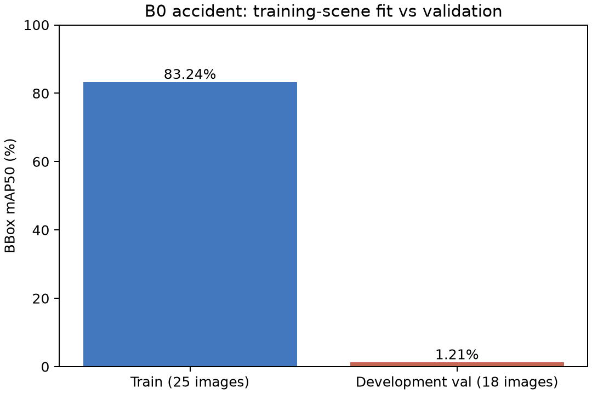
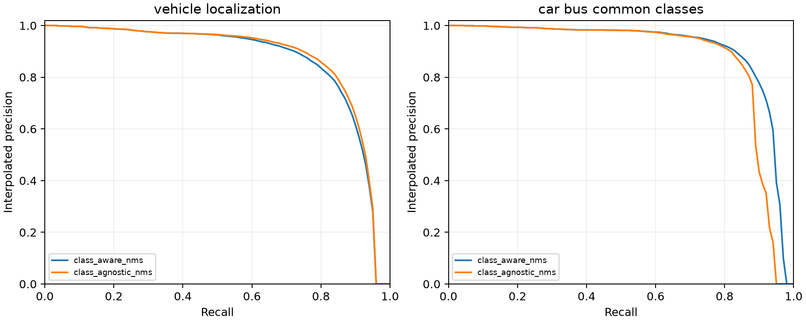

# Kết quả thực nghiệm có nguồn gốc dữ liệu

Bản tổng hợp sau phản hồi ngày16/11, hoàn tất kiểm tra ngày17/11/2026. Các con số dưới đây được chạy trên máy phát triển; **chưa có test độc lập khóa trước phát triển**. Số test phần mềm, bbox và ID không phải accuracy mô hình.

## Train và đánh giá trên đâu?

| Thành phần | Train | Đánh giá | Trạng thái |
| --- | --- | --- | --- |
| Detector xe trong demo | YOLOv8n COCO pretrained của nhà phát hành; chưa fine-tune xe trên dữ liệu đồ án | 2037ảnh DETRAC MVI_20011(664), MVI_20012(936), MVI_20032(437), nhãn XML nguồn | Development; đã dùng các cảnh này để phát triển, không gọi test |
| B0 accident | 25ảnh: T-T_crash_1 và V-V_crash_0;19dương/6âm;12epoch | 18ảnh: T-T_crash_2 và V-V_crash_1;12dương/6âm | STTAD ví dụ tác giả, validation phát triển; không có test |
| Cảnh báo B2 motion_contact_v5 | Luật thủ công sau detector, không phải model accident đã train | CADP/DETRAC đã dùng chỉnh luật | Chưa có precision/recall sự kiện độc lập |

[Nguồn YOLOv8 pretrained](https://docs.ultralytics.com/models/yolov8/), [nguồn DETRAC tác giả](https://sites.google.com/view/daweidu/projects/ua-detrac), [nguồn STTAD](https://github.com/ZTR02/STTAD). Metadata checkpoint xe cũng ghi `coco.yaml`. Không lấy mAP nhà phát hành làm kết quả đồ án.

## Detector xe: cùng checkpoint, cùng ảnh và protocol

P/R là micro tại **confidence0,25 / IoU0,50**; AP dùng điểm từ0,001, COCO101điểm, max100detection/ảnh.17.920bbox nguồn trước xử lý ignore. Vùng ignore XML và bbox truncation≥0,5 không là FP/FN bình thường; xem cấu hình để tái lập.

| Tác vụ | NMS | Precision@0,25 | Recall@0,25 | mAP50 | mAP50–95 | TP / FP / FN |
| --- | --- | ---: | ---: | ---: | ---: | --- |
| Định vị vehicle (1lớp) | Theo lớp — gốc | 81.68% | 81.69% | 86.42% | 50.76% | 14435 / 3237 / 3235 |
| Phân lớp car/bus (2lớp) | Theo lớp — gốc | 87.46% | 81.39% | 90.60% | 53.38% | 13341 / 1912 / 3050 |
| Định vị vehicle (1lớp) | Giữa các lớp — demo mới | 84.10% | 81.69% | 87.15% | 51.03% | 14435 / 2729 / 3235 |
| Phân lớp car/bus (2lớp) | Giữa các lớp — demo mới | 87.44% | 80.81% | 87.32% | 51.57% | 13245 / 1902 / 3146 |

**Không gộp hai tác vụ:** định vị vehicle gộp mọi lớp xe nên không đo phân biệt car/truck/bus. Phép đo2lớp chỉ có car/bus dùng chung; van/others nguồn là vùng ignore, không ép others thànhtruck. Vì thế chưa có mAP lớp truck/xe máy đáng tin cậy từ phép đo này.

NMS giữa lớp giảm FP định vị nhưng làm mAP50 car/bus giảm90,60→87,32% (−3,28điểm phần trăm). Không kết luận NMS mới nâng accuracy phân lớp từ việc video bớt khung trùng. Chưa dùng kết quả development này để tuyên bố cải thiện trên camera độc lập.

## B0 accident: kiểm lại checkpoint đã train

Các P/R trong bảng này là điểm trên đường PR do Ultralytics chọn theo F1; **không cùng định nghĩa operating point0,25 của bảng xe**. Train chỉ để chẩn đoán, không là kết quả kiểm tổng quát hóa.

| Split | Precision đường PR | Recall đường PR | mAP50 | mAP50–95 |
| --- | ---: | ---: | ---: | ---: |
| train | 78.75% | 68.42% | 83.24% | 64.64% |
| val | 2.62% | 16.67% | 1.21% | 0.35% |

Tại confidence0,25 / IoU0,50 trên validation: **TP=0, FP=0, FN=12; precision không xác định vì không có dự đoán, recall0%, F1=0**. Không ghi precision100% từ FP=0. Model này chưa được đưa vào demo.

mAP50 train83,24% nhưng validation1,21% cho thấy chưa chuyển được sang hai cảnh validation. Tập chỉ4cảnh ví dụ; nhãn âm do agent rà riêng12frame, chưa đối soát độc lập; phần thiếu nhãn không tự coi âm. Không dùng31frame dương để suy31sự kiện độc lập.





Bản xuất đồ thị: [B0 PDF](evidence/figures/2026-11-17-b0_train_val.pdf), [PR PDF](evidence/figures/2026-11-17-vehicle_pr.pdf). Số liệu CSV, prediction từng ảnh và kết quả từng chuỗi ở `outputs/audits/evaluation_2026-11-16/`; chỉ đồ thị/snapshot nhỏ được mang theo source.

## Protocol và bằng chứng

- [Config cố định trước phép đo xe](../configs/vehicle_evaluation.json). Hai profile chỉ khác NMS, giữ model640/conf/IoU/maxDet và tập ảnh. Không dùng lớp hiển thị/vote ID để chấm metric detector.
- [Config huấn luyện B0](../configs/b0_feasibility.json), [quy trình/giới hạn B0](B0_FEASIBILITY.md). Giữ manifest/split/review/checkpoint cũ.
- [Snapshot số liệu đọc được sau clone](evidence/2026-11-17-evaluation.json). Raw GT/predictions, hash từng ảnh, report và PR curves/CSV vẫn cục bộ trong audit; snapshot không chứng minh asset có trên máy mới.
- [COCO API](https://github.com/cocodataset/cocoapi/blob/master/PythonAPI/pycocotools/cocoeval.py) qua pycocotools2.0.11; đây là protocol development khai báo, **không phải official DETRAC benchmark**. Không báo FPS streaming từ chạy file/COCO cache.

```bash
.venv/bin/python -m pip install -r requirements-eval.txt
.venv/bin/python -B scripts/audit_b0_checkpoint.py --output outputs/experiments/b0_audit_repeat
.venv/bin/python -B scripts/evaluate_vehicle_detector.py --output outputs/experiments/vehicle_eval_repeat
.venv/bin/python -B scripts/summarize_experiments.py \
  --vehicle outputs/experiments/vehicle_eval_repeat/report.json \
  --b0 outputs/experiments/b0_audit_repeat/report.json \
  --output outputs/experiments/summary_repeat
```

Cần đúng ảnh/trọng số/XML theo catalog. Archive XML12,8MB đã khôi phục/khớp SHA; không tải bộ ảnh đầy đủ. Lượt đầu lỗi serialize kiểu NumPy sau khi đã suy luận đủ2037ảnh; giữ cache/log/producer cũ, sửa serializer và kiểm lại bộ test. Resume chỉ nhận stream đầy đủ/cùngprotocol/cùngảnh và ghi hash, không bịa lại thời gian inference. Hai profile đều có prediction từng ảnh; lỗi công cụ không bị ghi thành kết quả model.

## Việc nghiên cứu còn thiếu

1. Chọn và kiểm dataset tai nạn CCTV có vùng/onset và negative đầy đủ; chốt quy tắc accident, uncertain và nhóm camera/sự kiện. Chưa đủ dữ liệu để gọi tập hiện tại là benchmark nghiên cứu.
2. Tách trọn nhóm camera/nguồn/sự kiện thành train/validation/test, loại bản cắt/trùng/gần trùng trước split. Toàn bộ clip đã dùng demo/chỉnh luật để ở development. Khóa test trước tuning; không chia frame liên tiếp ngẫu nhiên.
3. Train B0 trên dữ liệu đủ/đã rà với cấu hình cố định; chọn threshold/checkpoint bằng validation, so baseline trên cùng protocol. Không tăng epoch trên25ảnh rồi gọi là đã giải quyết tổng quát hóa.
4. Chấm detection bbox bằngP/R/AP, cảnh báo bằng eventP/R/F1/FAR/hour/delay; chỉ sau đó so B1/B2/MLP/GRU. Không dùng mAP xe để thay chất lượng phát hiện tai nạn.

**Chưa đạt điều kiện nghiệm thu độ chính xác hoặc hoàn thành gate nghiên cứu.**
